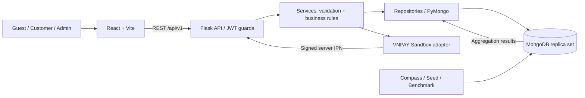

# Kiến trúc tổng thể

## Trạng thái và phạm vi

LOCKED DESIGN v1 — PHASE02/03/04 đã duyệt; PHASE05A implement13 Auth/User/Admin User endpoints trên Flask foundation/MongoDB đã khóa, không thay mô hình DB. Chưa full nghiệp vụ/frontend; không tự chuyển phase. Feature ngoài Auth/User được worker/phase riêng nghiệm thu. Modular monolith phù hợp nhóm3SV, MongoDB là CSDL chính. Quyết định tại [foundation](foundation-decisions.md) và [ADR index](decisions/README.md); bàn giao [phase05A review](phase-05a-review.md), [API contract](api-contract.md); lịch sử [phase04](phase-04-review.md), [phase03](phase-03-review.md), [phase02](phase-02-review.md). Sơ đồ dưới đây mô tả đích thiết kế, không khẳng định mọi component đã chạy.

## Luồng hệ thống

PHASE05B Catalog bổ sung14 public/Admin Category/Product method/path, API→service→repository đúng ranh giới. Product list/detail resolve Category hiện hành và kiểm tra ACTIVE bằng MongoDB lookup, không embed Category sống vào Product. catalog_schema chuyển request shape từ canonical validator, product_schema/category_schema bổ sung API rules; catalog_transaction orchestration snapshot/majority và retry hữu hạn. Product create/move/publish guarded Category version write; category archive/delete/type change cùng write guard/transaction với reference checks. Search/filter/sort/count/pagination chạy MongoDB, DTO trả attributes động. [Review PHASE05B](phase-05b-review.md). Frontend/checkout/reservation còn deferred theo phase được giao.

VNPAY ReturnUrl là kênh điều hướng về Web; chỉ server IPN đã xác minh mới cập nhật kết quả theo policy ở payment. Backend không gọi dịch vụ ngoài bên trong transaction có thể retry. COD hoàn tất không phụ thuộc VNPAY.

## Ranh giới các tầng

| Path | Trách nhiệm | Không làm |
| --- | --- | --- |
| backend/app/api | Flask Blueprint, HTTP, guard, parse/serialize | Trực tiếp tính doanh thu/tồn kho |
| backend/app/services | Use case, pricing, state transition, transaction orchestration | Phụ thuộc React/HTTP request toàn cục |
| backend/app/repositories | Mongo query/aggregate, nhận session từ service | Tự commit transaction nhiều repository |
| backend/app/schemas | Request/response validation, allowlists, type conversion | Thay thế DB validator hoàn toàn |
| backend/app/auth | JWT/hash/role/ownership guard | Tin role từ client |
| backend/app/db | MongoClient lifecycle/readiness, truy cập DB/session | Business rule; tự setup validator/index/seed trong factory |
| backend/app/errors | Error hierarchy/global HTTP envelope mapping | Leak traceback/received input |
| backend/app/utils | Lỗi/time/money/serialization dùng chung có nhu cầu thật | Gom tất cả logic vào utils |
| frontend/src/api | HTTP client/token/error, typed contracts | Tự xác nhận thanh toán |
| frontend/src/features | UI/state theo feature | Truy cập trực tiếp MongoDB |
| frontend/src/pages/layouts/routes | Ghép trang, layout shop/admin, điều hướng | Authorization duy nhất ở frontend |
| database | Artifacts validator/index/pipeline/sample được review | CSDL thứ hai, duplicate source of truth |
| scripts | Seed, import/export, đo hiệu năng | Lách rule để tạo data sai schema |
| tests | E2E liên Web/API; test tầng dưới ở từng ứng dụng | Dataset/secret production |

Module dự kiến dùng cặp `api/products.py`, `services/product_service.py`, `repositories/product_repository.py`, `schemas/product_schema.py`; các feature docs chỉ ra file liên quan. `checkout_service.py` sở hữu transaction chung; repository không mở transaction độc lập. Dashboard repository khi implementation load/decode Extended JSON pipeline canonical từ `database/aggregations`, bind range đã validate, không sao chép hai bản khác nhau.

Foundation thực tế tại `backend/app`: create_app/config; api/health.py → services/health_service.py → db readiness; auth JWT/Argon2/guards; schemas validation/pagination/query constants; errors handlers; utils BSON/responses/IDs/logging. PHASE05A thêm api/auth.py, users.py, admin_users.py → auth_service.py/user_service.py → user_repository.py với strict DTO/schema và local rate limiter. Profile/address/password/status chỉ sửa một User document, atomic conditional writes giữ version/default/tokenVersion; không tạo Cart hoặc cascade Order. MongoClient một instance/app/process, không đóng mỗi request; atexit và test fixture explicit close. Health và Auth/User blueprints được đăng ký trong app thường; các feature khác có registration của worker riêng. Feature agent dùng factory/register blueprint theo prefix, service gọi repository qua get_db(), session do service điều phối; cập nhật api-contract và feature docs khi endpoint thực sự implement. [Backend setup](backend-setup.md), [module map](../backend/README.md).

## Mô hình MongoDB và tính nhất quán

Product chung collection có discriminator. User/Category được reference ở tài liệu sống. Cart riêng (ADR-004). Order là aggregate lịch sử nhúng snapshot item/customer/address/category; Product reference chỉ phục vụ trace/link và trả tồn kho. Payment attempts riêng vì nhiều lần thử/callback có vòng đời khác Order. Review DEFERRED, không tạo collection/endpoint ở MVP.

Checkout cần transaction: conditional decrement tổng quantity/Product + insert Order + clear items và tăng đúng version Cart (giữ document), tạo payment attempt đầu nếu VNPAY. Snapshot, tiền và tồn kho phải commit cùng nhau. Hủy/hết hạn trả kho đúng một lần trong transaction có state guard. Môi trường chính đã khóa MongoDB Community8.0 local single-node replica set rs0/WiredTiger; standalone không đáp ứng transaction. Atlas chỉ deployment option về sau. Test startup phải nhận ra topology không phù hợp, không bỏ transaction âm thầm. [Nguồn MongoDB](https://www.mongodb.com/docs/manual/core/transactions/).

Giới hạn retry hữu hạn; callback transaction không gửi email/payment request. Index/validator tạo trước checkout. Đọc primary, transaction snapshot read concern và majority commit theo khả năng deployment; không tuyên bố local một node chịu lỗi như production.

## Auth và frontend

Guest là truy cập không đăng nhập, không phải persisted role. User chỉ `CUSTOMER`/`ADMIN`. Register chỉ tạo Customer; Admin bootstrap qua seed riêng. Access JWT thời hạn hữu hạn, frontend giữ trong memory, hết hạn đăng nhập lại; chưa thiết kế refresh token. Mỗi protected request kiểm tra User đang ACTIVE và `tokenVersion`, role hiện hành từ DB để khóa/đổi role có hiệu lực. Argon2id baseline m19456 KiB/t2/p1 theo foundation-decisions; benchmark hashing có thể tăng cost khi bootstrap, không thay database/schema.

Các trang shop: catalogue, chi tiết, đăng nhập/đăng ký, profile/addresses, Cart, Checkout, Order history/detail. Admin: Dashboard, Category/Product CRUD, Order/User management. Frontend route guard giúp UX; backend luôn enforce. UI tiền VND và ngày giờ Việt Nam; API trả UTC.

## Bản đồ đọc context theo task

Luôn đọc AGENTS + architecture; thêm schema/business-rules chỉ khi liên quan. Bảng bên dưới chỉ là dependency trực tiếp, không yêu cầu đọc toàn bộ docs của dependency nếu chỉ dùng contract.

| Task | Feature doc | Code dự kiến inspect | Dependency trực tiếp |
| --- | --- | --- | --- |
| Backend foundation | backend-foundation | app factory/config/db/errors/utils/schemas/auth, tests | API contract/conventions, auth User projection |
| Auth | auth | app/auth, api/auth.py, user repository; features/auth | users, API conventions |
| Profile/addresses | users | api/users.py, user service/repository; features/users | auth |
| Category | categories | category API/service/repository/schema; features/categories | products khi archive/delete |
| Product/read | products | product API/service/repository/schema; features/products | categories |
| Search/filter | search-filter | product repository/schema; features/search-filter | products, index ADR |
| Cart | cart | cart API/service/repository/schema; features/cart | Product current read, auth |
| Checkout | checkout | checkout service/API; cart/product/order repositories | cart, orders, payment adapter |
| Orders/customer | orders | order API/service/repository; features/orders | auth, immutable snapshots |
| Payment | payment | payment API/service/repository/provider; features/payment | orders state contract, checkout |
| Review | reviews | review API/service/repository; features/reviews | orders eligibility, products, auth |
| Admin Product | admin-products | admin product/category routes; features/admin-products | products/categories |
| Admin Order | admin-orders | admin order API, order service; features/admin-orders | orders/payment state contract |
| Admin User | admin-users | admin user API, user service; features/admin-users | auth tokenVersion |
| Dashboard | admin-dashboard | dashboard API/service/repository, aggregations; features/admin-dashboard | orders snapshot, users count |

## Những lựa chọn chưa triển khai

Frontend contract React/Vite/TypeScript/Tailwind/Recharts đã khóa; frontend agent khác làm sau. Images là URL-only, không upload/cloud. Ship/quote/payment TTL/limits đã khóa tại foundation-decisions. Search local normalized substring theo ADR008; không Atlas Search. Reviews/shadcn/ui/deployment deferred. DB tooling/backend foundation/Auth User đã triển khai; phần ngoài Auth/User theo worker riêng, full benchmark chưa chạy. Auth rate limit hiện local per process, chưa deployment/distributed limiter. Không cần Redis/queue/Elasticsearch/SQL cho MVP.
