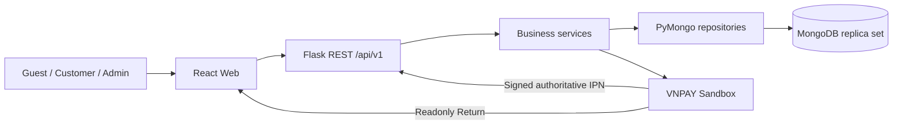

# BÁO CÁO ĐỒ ÁN MÔN NoSQL

# NOVAMART — SÀN THƯƠNG MẠI ĐIỆN TỬ ĐA NGÀNH HÀNG

Ngày tổng hợp:20/10/2026. Phiên bản nội dung kỹ thuật dựa trên source và evidence đã kiểm chứng.

**Thông tin hành chính chưa được cung cấp:** tên trường/khoa/lớp, giảng viên, họ tên và MSSV của3thành viên. Chưa suy đoán hoặc tự điền thông tin này. Đây là bản báo cáo Markdown để nhóm kiểm tra nội dung; chưa khẳng định đáp ứng biểu mẫu Word/PDF hoặc slide riêng của giảng viên.

## 1. Mục tiêu và phạm vi

Đồ án xây dựng ứng dụng Web kinh doanh nhiều ngành hàng, sử dụng MongoDB làm cơ sở dữ liệu nghiệp vụ chính. Sản phẩm minh họa mô hình dữ liệu đa hình, dữ liệu nhúng, truy vấn Aggregation Pipeline và compound index, đồng thời có luồng mua hàng và quản trị hoạt động thực tế.

Phạm vi theo đề: quản lý danh mục/sản phẩm, giỏ hàng, đặt đơn, giữ giá và thông tin sản phẩm tại thời điểm mua, Dashboard doanh thu theo thời gian và Top5bán chạy. Dữ liệu mẫu phải có ít nhất100Products thuộc ít nhất3ngành và50–100Orders với2–5sản phẩm mỗi đơn.

Các phần bổ sung do người dùng giao: Auth/User/address, tìm kiếm/lọc, quản lý đơn và người dùng, VNPAY Sandbox, chọn SKU với giá/tồn riêng và đánh giá từ đơn đã hoàn tất. Không triển khai Seller/Shipper/Staff, hoàn tiền tự động, coupon, guest checkout hoặc thanh toán tiền thật.

Nguồn phạm vi: [requirements](requirements.md), [bảng barem](final-rubric-matrix.md). Kết quả test không tự động quy đổi thành điểm do giảng viên chấm.

## 2. Kiến trúc và công nghệ

| Tầng | Công nghệ / trách nhiệm |
| --- | --- |
| Giao diện | React, Vite, TypeScript, Tailwind CSS; Recharts hiển thị thống kê từ API |
| API | Flask; prefix/api/v1; JWT và phân quyền; JSON envelope/validation/error handling |
| Nghiệp vụ | Service điều phối checkout, tồn kho, trạng thái Order, payment, reviews và transaction |
| Truy cập dữ liệu | PyMongo repository; tìm kiếm, cập nhật có điều kiện, aggregate |
| Database | MongoDB Community8.0/rs0 local; Atlas cho website demo public |
| Vận hành | Render backend và static frontend; API/expiry supervisor trong dịch vụ backend hiện hữu |



Kiến trúc modular monolith phù hợp phạm vi nhóm3sinh viên. Không đặt nghiệp vụ tồn kho/thanh toán ở component React. Frontend hiển thị dữ liệu trả về; MongoDB tính aggregation. API không trực tiếp truy cập hoặc sửa dữ liệu trên client.

Guest là người chưa đăng nhập, không phải role lưu trong users. Hai role được lưu là CUSTOMER và ADMIN. Register chỉ tạo CUSTOMER; backend kiểm tra quyền và trạng thái User hiện tại, không chỉ dựa vào việc ẩn nút trên UI.

## 3. Lựa chọn MongoDB

MongoDB cho phép các document trong cùng collection có tập field khác nhau và tổ chức dữ liệu theo cách truy cập. Vì vậy catalog nhiều loại sản phẩm có thể dùng document model thay vì bắt mọi ngành có cùng các cột. Đây là đặc tính mô hình dữ liệu, không có nghĩa MongoDB luôn nhanh hơn SQL. [MongoDB Data Modeling](https://www.mongodb.com/docs/manual/data-modeling/).

Trong Novamart, các field chung như tên, giá, tồn, danh mục và trạng thái nằm ở Product root; field khác nhau theo ngành nằm trong attributes. Ví dụ điện tử có ram/storage/chip, thời trang có sizes/colors/material, gia dụng có power/capacity/voltage. Cách này giảm số field rỗng và tránh tách collection cho mỗi ngành. productType phân biệt nhánh dữ liệu.

Trade-off của lựa chọn này: ứng dụng phải kiểm soát reference, kiểu thuộc tính và arithmetic; không được coi tính linh hoạt là bỏ mọi ràng buộc. Nhúng snapshot làm lặp một phần dữ liệu nhưng giúp hóa đơn giữ lịch sử. Index cần chọn theo query pattern, không tạo cho mọi tổ hợp thuộc tính.

JSON Schema xác định kiểu và quy tắc document; MongoDB hỗ trợ JSON Schema draft4 với các khác biệt riêng, gồm bsonType. [Schema Validation](https://www.mongodb.com/docs/manual/core/schema-validation/specify-json-schema/). Project dùng validator strict/error và service validation; validator không tự kiểm tra được mọi reference hoặc quy tắc nghiệp vụ nhiều document.

## 4. Thiết kế dữ liệu

### 4.1. Collections

| Collection | Nội dung chính | Nhúng / tham chiếu |
| --- | --- | --- |
| users | Account, role/status, password hash, địa chỉ, version/tokenVersion | Nhúng danh sách địa chỉ có giới hạn; không nhúng lịch sử Orders |
| categories | Danh mục một cấp, slug, productType, trạng thái | Product tham chiếu categoryId |
| products | Field chung, productType, attributes, ảnh, giá/tồn, optional matrixSKU/ratingSummary | Tham chiếu Category sống; nhúng SKU có giới hạn |
| carts | Giỏ của một User, items/selection/version | Tham chiếu Product, dùng giá hiện tại; chưa reserve kho |
| orders | Items và thông tin lịch sử, totals, lifecycle/payment | Nhúng snapshot sản phẩm/danh mục/khách/địa chỉ lúc mua |
| payment_attempts | Mỗi lần thử VNPAY, reference/checksum receipt/deadline/state | Tham chiếu Order/User; không tạo Order mới khi retry |
| reviews | Rating/nhận xét của User từ Order đã hoàn tất | Tham chiếu User/Order/Product; public DTO che tên và ẩn identifiers riêng |

Thiết kế ban đầu có6collections; reviews được bổ sung theo [ADR013](decisions/013-sku-review-hardening.md), không tạo collection riêng cho từng ngành. Các ghi chú phase cũ được đọc theo thời điểm; schema hiện hành là7collections.

### 4.2. Polymorphic Product và JSON Schema

Ba document thực dưới đây chỉ trích các field phục vụ giải thích, không phải payload đầy đủ để import:

```json
[
  {
    "sku": "DEMO-ELE-001",
    "productType": "ELECTRONICS",
    "attributes": {
      "sourceCategory": "laptops",
      "sourceProductId": 78,
      "dimensions": {
        "width": "20.03 cm",
        "height": "9.54 cm",
        "depth": "14.82 cm"
      },
      "ram": "8GB",
      "storage": "256GB",
      "chip": "Demo CPU A",
      "screen": "15.6 inch",
      "battery": "60Wh"
    }
  },
  {
    "sku": "DEMO-FAS-001",
    "productType": "FASHION",
    "attributes": {
      "sourceCategory": "mens-shirts",
      "sourceProductId": 83,
      "dimensions": {
        "width": "27.49 cm",
        "height": "23.73 cm",
        "depth": "28.61 cm"
      },
      "sizes": [
        "S",
        "M",
        "L",
        "XL"
      ],
      "colors": [
        "Blue",
        "White",
        "Black"
      ],
      "material": "Cotton",
      "gender": "Unisex",
      "fit": "Regular",
      "care": "Wash at 30 C"
    }
  },
  {
    "sku": "DEMO-HOM-019",
    "productType": "HOME_APPLIANCE",
    "attributes": {
      "sourceCategory": "kitchen-accessories",
      "sourceProductId": 61,
      "dimensions": {
        "width": "27.31 cm",
        "height": "21 cm",
        "depth": "24.27 cm"
      },
      "material": "Food-safe composite",
      "capacity": "1L",
      "dishwasherSafe": true,
      "useCase": "Hand Blender",
      "care": "Clean after use",
      "power": "800W",
      "voltage": "220V"
    }
  }
]
```

[Validator Product đầy đủ](../database/validators/products.json) được nộp kèm source. Root kiểm tra các field bắt buộc, ObjectId/Date, giá BSONlong, tồn và version int. productType có3giá trị ELECTRONICS/FASHION/HOME_APPLIANCE; oneOf chọn nhánh và kiểm tra các thuộc tính ngành khi có. attributes có giới hạn cấu trúc/độ sâu; không mở field tùy ý ở root.

| Quy tắc | Cơ chế |
| --- | --- |
| Field chung đúng tên/kiểu và không chèn root lạ | $jsonSchema.required/properties/additionalProperties |
| Chọn ngành hợp lệ | productType enum + oneOf |
| Tiền là integer VND, không dùng float | BSONlong ở database, JSON integer trong API |
| SKU/slug không trùng | Unique indexes |
| Category tồn tại, ACTIVE và cùng productType | Service + guarded transaction; không chỉ validator |
| Root tồn/giá khớp matrix | Server tính sumSKUstock/minSKUprice và kiểm tra trong nghiệp vụ |

### 4.3. Embedded Order và snapshot

Cart lấy giá Product hiện hành; checkout mới chụp dữ liệu vào Order. Order detail và báo cáo không JOIN Product hiện tại để khôi phục giá lịch sử. productId giữ cho truy vết và hoàn kho theo rule.

Trích Order demo đã tạo qua API; bỏ thông tin cá nhân và các field nội bộ khỏi ví dụ:

```json
{
  "orderCode": "ORD-6AD71662EC77AC8C719DAF03",
  "items": [
    {
      "sku": "DEFENSE-FINAL-SKU",
      "productName": "Áo demo SKU — chọn M hoặc XL",
      "quantity": 1,
      "priceAtPurchase": 100000,
      "lineTotal": 100000,
      "selectedAttributes": {
        "Size": "M",
        "skuId": "DEFENSE-FINAL-SKU-M"
      }
    },
    {
      "sku": "DEFENSE-FINAL-SNAPSHOT",
      "productName": "Áo demo snapshot — giá cũ được giữ",
      "quantity": 1,
      "priceAtPurchase": 50000,
      "lineTotal": 50000,
      "selectedAttributes": {}
    }
  ],
  "subtotal": 150000,
  "shippingFee": 30000,
  "total": 180000,
  "orderStatus": "COMPLETED",
  "paymentStatus": "PAID"
}
```

Ở checkpoint, Product DEFENSE-FINAL-SNAPSHOT có giá hiện60.000VND nhưng item trong Order vẫn50.000VND. Order COMPLETED/PAID giữ subtotal150.000, shipping30.000, total180.000. Mã Order này là **API preparation**, không gọi là đơn vừa tạo trực tiếp trên Web khi bảo vệ. [Receipt](../backend/evidence/defense-demo-final-20261020.json).

Order đầy đủ còn nhúng customerSnapshot, shippingAddress, categoryId/categoryName/productType và attributesSnapshot ở items. Không nhúng toàn bộ User/Product sống hoặc lịch sử Order vào User. [Validator Order](../database/validators/orders.json), [schema chi tiết](database-schema.md).

## 5. Các luồng nghiệp vụ

### 5.1. Catalog và mua hàng

Guest duyệt/tìm/lọc/xem chi tiết. Customer đăng nhập, bấm mua để mở bảng chọn phân loại, chọn SKU/số lượng rồi thêm Cart. Giá/tồn lấy từ server; không nhận giá client tự khai. Cùng SKU phải gộp một dòng kể cả request có/không skuId optional.

Sau khi chọn địa chỉ, checkout quote có chữ ký và thời hạn. Tạo Order kiểm tra lại Cart version, Product/Category/trạng thái/giá/tồn. Cùng ý định checkout dùng Idempotency-Key để retry an toàn. Order history/detail chỉ trả tài nguyên của Customer đang đăng nhập.

### 5.2. Transaction và tồn kho

MongoDB cung cấp transaction nhiều document trên replica set/sharded cluster; project dùng replica set để thực hiện các write liên quan cùng transaction. [Transactions](https://www.mongodb.com/docs/manual/core/transactions/).

Checkout thực hiện atomic: guarded Category/Product → trừ tồn theo SKU và root → insert Order snapshot → tạo initial online attempt nếu cần → clear Cart và tăng version. Lỗi giữa chừng rollback toàn bộ. Conditional update ngăn stock âm; retry hữu hạn và revalidate khi có conflict.

Cancel/expiry có state/version guard và marker stockReleasedAt để trả kho đúng một lần. Product archived vẫn có thể nhận trả kho theo rule. Không cộng tồn thủ công hoặc reset seed sau khi demo. Single-node local phục vụ chức năng transaction, không chứng minh khả năng chịu lỗi của production nhiều node.

### 5.3. COD, Admin và doanh thu

COD mới đặt có PENDING/UNPAID. Admin confirm→ship→complete; complete đồng thời ghi COMPLETED/PAID/paidAt/completedAt. Đơn PAID/đã giao hoặc hoàn tất không cho Customer hủy tùy ý. Lịch sử/totals/snapshot không sửa theo Product sống.

### 5.4. VNPAY Sandbox

Backend ký URL từ tổng tiền Order, xác minh merchant/reference/amount/chữ ký và các provider status khi nhận IPN. **Return chỉ hiển thị/đọc trạng thái; IPN hợp lệ mới cập nhật authoritative.** Callback trùng không trừ kho hoặc ghi nhận tiền thêm lần nữa. Retry attempt không tạo lại Order hoặc kéo dài deadline15phút.

Failure giữ Order có thể retry trước deadline; success tới muộn/cạnh tranh với cancel/expiry có policy REVIEW_REQUIRED, không hồi sinh Order và cộng doanh thu sai. Expiry worker chạy cùng dịch vụ backend qua supervisor; cutoff cố định giữ5fixture online lịch sử của seed.

Đã kiểm thử2giao dịch NCB/testOTP/automaticIPN/Return và bộ SIT chính thức6/6Đạt. Expected/actual RspCode00/00/01/02/04/97 cho success/failure/unknown/duplicate/amount/checksum. Đây là Sandbox, không tiền thật hoặc chứng nhận merchant production. [Payment review](vnpay-sandbox-final-review.md).

### 5.5. Reviews và bảo mật

Customer chỉ review Product có trong Order của mình, COMPLETED+PAID. Unique User/Order/Product chống gửi trùng; insert review và cập nhật ratingSummary cùng transaction. Demo review4sao được ghi rõ là dữ liệu trình diễn, không giả phản hồi mua hàng thật.

JWT được xác minh signature/expiry/issuer/audience và User role/status/tokenVersion hiện tại. Password dùng Argon2id; backend giữ quyền Admin/ownership, allowlist payload và query, bounded pagination, ObjectId serialization, global errors. Các case Guest/Customer vàoAdmin, xem Order người khác, invalidJWT, blockedaccount, tamperpayload có tests. Không coi các kiểm tra này là pentest toàn diện.

## 6. Aggregation Pipeline

Aggregation xử lý document theo chuỗi stage và tạo kết quả tổng hợp trên MongoDB. [Aggregation Pipeline](https://www.mongodb.com/docs/manual/core/aggregation-pipeline/). Novamart có8canonical pipelines; repository load/bind range, Flask thêm metadata/bucket0 khi cần, React chỉ render kết quả.

Định nghĩa doanh thu: Order COMPLETED+PAID; lọc `[from,to)` theo completedAt; merchandise revenue=subtotal-discount, không shipping; nhóm ngày/tháng theo Asia/Ho_Chi_Minh. Order count/status dùng createdAt; Customer count là toàn cục, không phải cùng cohort với revenue.

### 6.1. Top5sản phẩm bán chạy

Trích nguyên canonical pipeline tại thời điểm báo cáo. Hai Date trong file là range mẫu, backend bind from/to của request; không gọi đây là range cố định cho mọi Dashboard.

```json
[
  {
    "$match": {
      "orderStatus": "COMPLETED",
      "paymentStatus": "PAID",
      "completedAt": {
        "$gte": {
          "$date": "2026-08-31T17:00:00Z"
        },
        "$lt": {
          "$date": "2026-09-30T17:00:00Z"
        }
      }
    }
  },
  {
    "$sort": {
      "completedAt": -1,
      "_id": -1
    }
  },
  {
    "$unwind": "$items"
  },
  {
    "$group": {
      "_id": "$items.productId",
      "productName": {
        "$first": "$items.productName"
      },
      "quantity": {
        "$sum": "$items.quantity"
      },
      "revenue": {
        "$sum": "$items.lineTotal"
      }
    }
  },
  {
    "$sort": {
      "quantity": -1,
      "revenue": -1,
      "_id": 1
    }
  },
  {
    "$limit": 5
  },
  {
    "$project": {
      "_id": 0,
      "productId": "$_id",
      "productName": 1,
      "quantity": 1,
      "revenue": 1
    }
  }
]
```

$match chọn qualified sales; sort đầu lấy nhãn snapshot mới nhất; $unwind tách items; $group theo productId và cộng quantity/lineTotal; sort xếp số lượng giảm dần, rồi revenue, rồi ID; limit5. Không sum Order.total sau unwind vì sẽ lặp tổng đơn theo số item. Không $lookup giá Product sống.

### 6.2. Doanh thu theo ngày

```json
[
  {
    "$match": {
      "orderStatus": "COMPLETED",
      "paymentStatus": "PAID",
      "completedAt": {
        "$gte": {
          "$date": "2026-08-31T17:00:00Z"
        },
        "$lt": {
          "$date": "2026-09-30T17:00:00Z"
        }
      }
    }
  },
  {
    "$group": {
      "_id": {
        "$dateTrunc": {
          "date": "$completedAt",
          "unit": "day",
          "timezone": "Asia/Ho_Chi_Minh"
        }
      },
      "revenue": {
        "$sum": {
          "$subtract": [
            "$subtotal",
            "$discount"
          ]
        }
      },
      "orders": {
        "$sum": 1
      }
    }
  },
  {
    "$sort": {
      "_id": 1
    }
  }
]
```

Cùng định nghĩa qualified/date basis; $dateTrunc tạo bucket ngày Việt Nam và $sum cộng tiền hàng. Để so Compass và Dashboard, phải bind cùng from/to/timezone; raw populated buckets có thể ít hơn series có bucket0 do backend điền.

## 7. Compound index và kiểm thử hiệu năng

Compound index gồm nhiều field; thứ tự và prefix ảnh hưởng những query được hỗ trợ. [Compound Indexes](https://www.mongodb.com/docs/manual/core/indexes/index-types/index-compound/). Project chọn index theo query pattern, không tự thêm cho mọi filter.

Ví dụ ix_products_category_price có status/categoryId trước, price/_id sau để hỗ trợ equality, range và sắp xếp ổn định. Index tăng storage và chi phí write; không khẳng định index tự tính hết $group hoặc mọi query đều được tăng tốc.

Benchmark07B dùng dataset riêng30.000Products/10.000Orders, không thay seed nghiệp vụ.5warmups/30samples mỗi mode, fully materialized cursor, đo local warm cache:

| Truy vấn | Docs trước→sau | Kết quả cuối | Natural p50/p95ms | Named p50/p95ms |
| --- | --- | --- | --- | --- |
| Category/price selector |30.000→20|20Products bằng nhau|29,103/42,596|1,200/3,077|
| Full Product repository category/price |30.000→96|1facet chứa20items|44,919/83,524|17,776/30,518|
| Revenue day |10.000→152|7rows|16,149/21,643|2,974/5,254|
| Top5 |10.000→152|5rows|22,540/28,986|3,726/8,039|

COLLSCAN/IXSCAN, docs/keys, true-before/natural/named/unhinted và equality outputs được lưu trong [performance summary](evidence/performance/benchmark-summary.md). Đây là kết quả đo07B, không chạy lại trong lượt viết báo cáo20/10. Không dùng selector để tuyên bố latency toàn API/production hoặc tốc độwrite. Hint natural không có nghĩa index vừa bị drop.

## 8. Dữ liệu mẫu, export/import và integrity

Seed chính:180Products,60mỗi ngành,40Users,100Orders mỗi2–5items. Mức này đáp ứng định mức đề; không yêu cầu live luôn đúng100Orders sau demo. [Seed manifest](../database/evidence/seed-manifest-ecommerce_dev.json).

Checkpoint hiện hành:44Users/6Categories/184Products/3Carts/102Orders/30Attempts/1Review. Phần tăng là account và fixtures được giữ có chủ đích; không tạo lại seed để ép counts.7validators/16declared+7_id_indexes,0invalid documents; kiểm tra reference/invariant mới nhất có receipt riêng.

Canonical Extended JSON full7collections đã export/import từ Atlas sang localDB mới ecommerce_defense. Documents, BSONtypes, collection options/validators/indexes và canonical fingerprint bằng nhau. Atlas read-only trong thao tác copy; localdev và testDB giữ nguyên. [Export/import receipt](../backend/evidence/defense-export-import-20261020.json).

Fingerprint so sánh full corpus trước/sau từng phạm vi thử; cleanup chỉ xóa document thuộc fixture có ownership journal/private backup. Fingerprint không thay validator, authorization hoặc kiểm thử nghiệp vụ; không dùng để tuyên bố data bất biến toàn thời gian khi người dùng có write hợp lệ.

## 9. Kết quả kiểm thử và triển khai

| Hạng mục | Evidence và phạm vi |
| --- | --- |
| Backend |714passed/0failed/0errors/0skipped,116,247s, realrs0 tại audit20/10 saufixCart; không chạy lại khi chỉ viết docs |
| Frontend | TypeScript strict/buildPASS,6/6payment status tests; audit dependency0knownfindings tại lượt đo, vẫn còn cảnh báo bundle khoảng930kB |
| Public regression |66HTTPSchecksPASS trên bản Cart đãdeploy: auth/ACL/SKU/Cart/COD/idempotency/snapshot/cancel/Admin/revenue/reviews/tampering/CORS và exactcleanup |
| Payment |2realSandboxNCB/testOTP/automaticIPN/Return;6officialSITcasesPASS; không productionpayment |
| Local fallback |20HTTPchecksCOD/idempotency/cancel/stock-once/VNPAYdisabled503PASS; exactcleanup |
| Browser | Các scope responsive/polymorphic/guards trước đó và demoSKU/review/localOrder; không gọi đây là rerun nguyên22/32historicalUIflows |
| Database | Canonical validators/indexes và originalcorpus unchanged khi loại đúng fixture;0invalid/orphan/invariant findings trong scope receipt |

Lỗi thực tế cuối đã sửa: optional skuId khiến cùng SKU xuất hiện hai dòng và bypass giới hạn99mỗi dòng. Bổ sung4regressions thất bại trước fix; POSTadd canonicalize identity và merge aliases trước kiểm tra. Full714tests và66publicchecks đãPASS trên bản sửa. [Audit](full-project-audit-20261020.md).

Public Web: https://novamart-web.onrender.com . APIhealth: https://novamart-api.onrender.com/api/v1/health . Backend application ef5e553, frontend ef9a481 trong checkpoint này; các commit docs/tooling sau đó không thay appbundle. Local Web5173/API5000/Mongo27017 dùng ecommerce_defense; không tự đồng bộ với Atlas.

## 10. Phân công nhóm và kịch bản bảo vệ

Bảng dưới là phân công theo đề, chưa điền tên/MSSV hoặc tự khẳng định số giờ/đóng góp của từng người.

| Vai trò | Trách nhiệm trình bày |
| --- | --- |
| SV1 — Data Architect/CRUD | Polymorphic Schema, Embedded Order, CRUD, checkout transaction và snapshot |
| SV2 — Advanced Query | Revenue/Top5, định nghĩa metric, compound index/explain và giới hạn benchmark |
| SV3 — Fullstack/DB Tester | Seed/export-import/Compass, Web/Dashboard, evidence, vận hành và điều phối demo |

Kịch bản5phút ưu tiên ba Product trong Compass → checkout Web2items → đổi giá không đổi snapshot → Dashboard/Top5 → index evidence. Bản10phút thêm Admin lifecycle và revenue delta. Hướng dẫn có sẵn: [5phút](demo-script-5min.md), [10phút](demo-script-10min.md), [Compass](compass-demo-steps.md), [Q&A](defense-qa.md).

## 11. Giới hạn và phần chưa hoàn tất

Phần mềm chính và các nội dung kỹ thuật theo barem đã có implementation/evidence. Chưa gọi toàn bộ phần nộp/bảo vệ hoàn thành vì còn:

1. SV3 thực hiện Compass GUI Documents/Order/Aggregation/Explain và Export/Import; PyMongo/API receipts không thay evidence GUI.
2. Ba SV luyện có bấm giờ và xác nhận kết quả thực tế. Agent không thay phần nói/phối hợp của nhóm.
3. Điền thông tin hành chính và kiểm tra biểu mẫu báo cáo/slide yêu cầu bởi giảng viên.
4. Nếu cần offlineOS, nhóm tự ngắt Internet rồi thử COD local. Đây là phương án dự phòng; VNPAY và ảnhCDN vẫn cần mạng. Chưa có bằng chứng ngắtOS trong checkpoint.

Không cam kết điểm, không tuyên bố pentest/productionSLA/fault-tolerance hoặc payment production. JS bundle còn cảnh báo kích thước;26/320imageURLs chưa xác minh được quaHEAD trong audit cũ không được kết luận tất cả hỏng, vì có ảnh vẫn render được trên browser.

## 12. Kết luận

Novamart thể hiện ba nội dung NoSQL trọng tâm: Product đa hình có validator, Order nhúng snapshot bất biến và thống kê trên MongoDB Aggregation. CRUD và luồng mua/quản trị hoạt động cùng auth/transaction/version/idempotency; có benchmark/index evidence và kiểm thử trên replica set thật.

Dự án sẵn sàng để nhóm hoàn thiện hồ sơ theo mẫu và rehearsal bảo vệ. Bảng chi tiết [final-rubric-matrix.md](final-rubric-matrix.md) và [submission-checklist.md](submission-checklist.md) phân biệt phần đã chứng minh với phần người thật còn cần xác nhận.

## 13. Phụ lục nộp kèm và tài liệu tham khảo

- Source backend/frontend, lockfiles và hướng dẫn cấu hình không chứa secrets.
- [Canonical validators](../database/validators/README.md), [indexes](../database/indexes/candidate-indexes.json), [aggregations](../database/aggregations/README.md), seed generator và manifest.
- [Fullaudit20/10](full-project-audit-20261020.md), [Sandbox/SITreview](vnpay-sandbox-final-review.md), [demo/localhandoff](defense-final-handoff-20261020.md), [evidenceindex](defense-evidence-index.md).
- MongoDB official documentation được liên kết tại mục3/5/6/7; các số liệu thực nghiệm của đồ án lấy từ receipts của repository, không từ tài liệu vendor.
- Không nộp.env/.local, credentials, fullprivateDBbackup, virtualenv/node_modules/cache hoặc ghi merchantsecret vào báo cáo.
