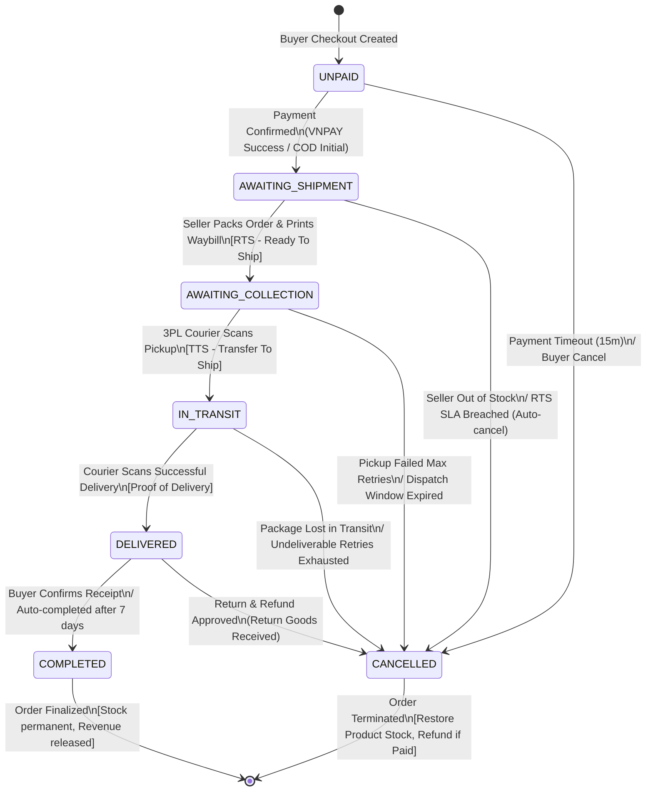

# TikTok Shop Commerce Clean-Room Specification

Tài liệu này xác lập đặc tả kiến trúc (Clean-Room Specification) dựa trên việc đối chiếu và phân tích chuẩn Open API thương mại điện tử quốc tế của TikTok Shop (Partner Center OpenAPI v202309 / Seller Central / Public Storefront), chuẩn hoá cho hệ thống thương mại điện tử **Novamart** vận hành trên **MongoDB Community 8.0 (WiredTiger Storage Engine)**.

Toàn bộ đặc tả được xây dựng theo phương pháp Clean-Room: trích xuất trừu tượng hoá data contract, state machine và cấu trúc lưu trữ BSON/JSON, không sao chép mã nguồn thực thi hay vi phạm bản quyền phần mềm độc quyền.

---

## 1. Executive Summary & Architecture Gaps

### 1.1. Bối cảnh & Mục tiêu
- **Mục tiêu**: Nâng cấp kiến trúc dữ liệu của Novamart từ mô hình thương mại điện tử cơ bản lên chuẩn Marketplace hiện đại tương tự TikTok Shop:
  1. Hỗ trợ **Dynamic PIM Specifications** (quản lý thông số kỹ thuật động theo danh mục lá với ràng buộc kiểu dữ liệu chặt chẽ).
  2. Bổ sung hệ thống **UGC Reviews & Ratings** (đánh giá xác thực kèm media, snapshot SKU khi mua, kiểm duyệt và tính toán aggregate stats tối ưu).
  3. Mở rộng **Order & Fulfillment State Machine** từ 6 trạng thái cơ bản sang quy trình chuẩn logistics đa chặng (RTS, TTS, 3PL transit, delivery confirmation).
- **Hạ tầng cơ sở**: MongoDB 8.0 WiredTiger, Replica Set `rs0`, Document-Level Locking, Snapshot Isolation Transactions, JSON Schema Validation.

### 1.2. Phân tích Khoảng cách Kiến trúc (Architecture Gap Matrix)

| Chiều kiến trúc | Hiện trạng Novamart (Baseline Phase 07) | Chuẩn TikTok Shop Partner API | Khoảng cách & Rủi ro kiến trúc (Gaps) | Giải pháp Clean-Room đề xuất |
| :--- | :--- | :--- | :--- | :--- |
| **PIM & Thuộc tính danh mục** | Đối tượng `attributes` tự do trên `products` (`patternProperties` nhận tối đa 30 key bất kỳ, không có từ điển danh mục). | OpenAPI `/product/categories/{id}/attributes`: Mỗi danh mục lá định nghĩa danh sách thuộc tính có `attribute_id`, `input_type`, `is_required`, `value_list`. | Không thể validate tính hợp lệ của thuộc tính theo ngành; tìm kiếm/lọc faceted search bị phân mảnh; dữ liệu rác dễ lọt vào DB. | Tạo collection `category_specifications` định nghĩa catalog rules; validate payload sản phẩm theo metadata của danh mục lá. |
| **Đánh giá & Xếp hạng (UGC Reviews)** | Bị DEFERRED tại Phase 02 (`docs/features/reviews.md`). Không có collection lưu trữ, không có điểm rating trên sản phẩm. | OpenAPI Customer Review: Collection độc lập, verified purchase, lưu media (ảnh/video), snapshot SKU, upvote hữu ích, trả lời của shop, rating breakdown. | Thiếu bằng chứng xã hội (Social Proof); nếu embed mảng review vào document `Product` sẽ gây hiện tượng **Document Relocation** nghiêm trọng trên WiredTiger. | Thiết kế collection `reviews` riêng biệt; tính toán và cache `ratingSummary` trực tiếp trên document `products` thông qua atomic `$inc`. |
| **Vòng đời đơn hàng (Order Lifecycle)** | Trạng thái gộp: `PENDING` -> `CONFIRMED` -> `SHIPPING` -> `COMPLETED`/`CANCELLED`. Không phân biệt khâu đóng gói và bàn giao. | Logistics API: `UNPAID` -> `AWAITING_SHIPMENT` -> `AWAITING_COLLECTION` (RTS) -> `IN_TRANSIT` (TTS) -> `DELIVERED` -> `COMPLETED`. | Không thể theo dõi SLA chuẩn của người bán (RTS SLA) và SLA hãng vận chuyển (TTS/Delivery SLA); không xử lý được tranh chấp giao vận chi tiết. | Mở rộng state machine sang 7 trạng thái chuẩn logistics quốc tế; bổ sung sub-document `fulfillment` và `sla` tracking. |

---

## 2. BSON/JSON Schemas (Category Specs, Reviews, Order Lifecycle)

### 2.1. Dynamic Category Specifications Schema (`category_specifications`)
Collection `category_specifications` đóng vai trò là Product Information Management (PIM) Rules Engine, liên kết `1-1` với mỗi danh mục lá (`categoryId`).

```json
{
  "_id": { "$oid": "670c00000000000000000001" },
  "schemaVersion": 1,
  "categoryId": { "$oid": "670c10000000000000000010" },
  "productType": "ELECTRONICS",
  "categoryName": "Điện thoại & Máy tính bảng",
  "version": 1,
  "attributes": [
    {
      "attributeId": "attr_elec_ram",
      "name": "Dung lượng RAM",
      "nameEn": "RAM Capacity",
      "type": "PRODUCT_PROPERTY",
      "inputType": "SELECT",
      "unit": "GB",
      "isRequired": true,
      "isCustomizable": false,
      "values": [
        { "valueId": "ram_4gb", "label": "4 GB", "labelEn": "4 GB" },
        { "valueId": "ram_8gb", "label": "8 GB", "labelEn": "8 GB" },
        { "valueId": "ram_16gb", "label": "16 GB", "labelEn": "16 GB" },
        { "valueId": "ram_32gb", "label": "32 GB", "labelEn": "32 GB" }
      ]
    },
    {
      "attributeId": "attr_elec_storage",
      "name": "Bộ nhớ trong",
      "nameEn": "Internal Storage",
      "type": "PRODUCT_PROPERTY",
      "inputType": "SELECT",
      "unit": "GB",
      "isRequired": true,
      "isCustomizable": false,
      "values": [
        { "valueId": "rom_64gb", "label": "64 GB", "labelEn": "64 GB" },
        { "valueId": "rom_128gb", "label": "128 GB", "labelEn": "128 GB" },
        { "valueId": "rom_256gb", "label": "256 GB", "labelEn": "256 GB" },
        { "valueId": "rom_512gb", "label": "512 GB", "labelEn": "512 GB" },
        { "valueId": "rom_1tb", "label": "1 TB", "labelEn": "1 TB" }
      ]
    },
    {
      "attributeId": "attr_elec_screen_size",
      "name": "Kích thước màn hình",
      "nameEn": "Screen Size",
      "type": "PRODUCT_PROPERTY",
      "inputType": "NUMERIC",
      "unit": "inch",
      "isRequired": false,
      "isCustomizable": true,
      "validationRules": {
        "min": 1.0,
        "max": 100.0
      }
    },
    {
      "attributeId": "attr_elec_connectivity",
      "name": "Kết nối không dây",
      "nameEn": "Wireless Connectivity",
      "type": "PRODUCT_PROPERTY",
      "inputType": "MULTI_SELECT",
      "isRequired": false,
      "isCustomizable": true,
      "values": [
        { "valueId": "conn_5g", "label": "5G", "labelEn": "5G" },
        { "valueId": "conn_wifi6", "label": "Wi-Fi 6", "labelEn": "Wi-Fi 6" },
        { "valueId": "conn_bluetooth5", "label": "Bluetooth 5.3", "labelEn": "Bluetooth 5.3" },
        { "valueId": "conn_nfc", "label": "NFC", "labelEn": "NFC" }
      ]
    }
  ],
  "createdAt": { "$date": "2026-10-15T00:00:00.000Z" },
  "updatedAt": { "$date": "2026-10-15T00:00:00.000Z" }
}
```

#### Phân cấp thuộc tính cho 3 ngành hàng mục tiêu:
1. **Điện tử (ELECTRONICS)**:
   - `attr_elec_warranty_months`: NUMERIC (Tháng bảo hành: 1 - 60).
   - `attr_elec_processor`: TEXT (Chipset / CPU).
   - `attr_elec_battery_capacity`: NUMERIC (Dung lượng pin mAh).
   - `attr_elec_screen_resolution`: SELECT (`HD+`, `FHD+`, `2K`, `4K`).
2. **Thời trang (FASHION)**:
   - `attr_fas_material`: MULTI_SELECT (`Cotton`, `Polyester`, `Spandex`, `Lụa`, `Linen`).
   - `attr_fas_gender`: SELECT (`Unisex`, `Nam`, `Nữ`, `Trẻ em`).
   - `attr_fas_pattern`: SELECT (`Trơn`, `Kẻ caro`, `Họa tiết`, `In hình`).
   - `attr_fas_care_instructions`: TEXT (Hướng dẫn giặt là / bảo quản).
   - `attr_fas_season`: SELECT (`Xuân Hè`, `Thu Đông`, `Bốn mùa`).
3. **Gia dụng (HOME_APPLIANCE)**:
   - `attr_home_power_watt`: NUMERIC (Công suất tiêu thụ W).
   - `attr_home_capacity_liter`: NUMERIC (Dung tích chứa Lít).
   - `attr_home_voltage`: SELECT (`220V`, `110V`, `Dual Voltage`).
   - `attr_home_noise_level_db`: NUMERIC (Độ ồn dB).
   - `attr_home_cordless`: SELECT (`Có dây`, `Dùng pin/không dây`).

---

### 2.2. UGC Customer Reviews & Ratings Data Model (`reviews`)

```json
{
  "_id": { "$oid": "670d00000000000000000001" },
  "schemaVersion": 1,
  "productId": { "$oid": "670a00000000000000000001" },
  "orderId": { "$oid": "670b00000000000000000001" },
  "orderCode": "ORD-6AC7A53587E692850A155388",
  "userId": { "$oid": "670900000000000000000001" },
  "userSnapshot": {
    "displayName": "h***g",
    "avatarUrl": "https://img.novamart.vn/avatars/user-01.webp"
  },
  "skuSpecSnapshot": {
    "color": "Titan Xanh",
    "storage": "256GB"
  },
  "rating": 5,
  "reviewText": "Giao hàng cực nhanh, máy nguyên seal chính hãng, đóng gói bọc chống sốc cẩn thận 5 lớp.",
  "media": [
    {
      "mediaId": "med_01",
      "type": "IMAGE",
      "url": "https://img.novamart.vn/reviews/rev-01-1.webp",
      "thumbnailUrl": "https://img.novamart.vn/reviews/thumbs/rev-01-1.webp",
      "width": 1080,
      "height": 1440
    },
    {
      "mediaId": "med_02",
      "type": "VIDEO",
      "url": "https://video.novamart.vn/reviews/rev-01-unbox.mp4",
      "thumbnailUrl": "https://img.novamart.vn/reviews/thumbs/rev-01-video.webp",
      "width": 720,
      "height": 1280,
      "durationSeconds": 15
    }
  ],
  "verifiedPurchase": true,
  "helpfulCount": 24,
  "sellerReply": {
    "replyText": "Novamart cảm ơn quý khách đã tin tưởng và đánh giá 5 sao. Chúc bạn có trải nghiệm tuyệt vời!",
    "repliedAt": { "$date": "2026-10-15T04:30:00.000Z" }
  },
  "status": "VISIBLE",
  "version": 1,
  "createdAt": { "$date": "2026-10-15T02:00:00.000Z" },
  "updatedAt": { "$date": "2026-10-15T04:30:00.000Z" }
}
```

---

### 2.3. Order Lifecycle & Fulfillment Schema Extension (`orders`)
Mở rộng document `orders` hiện có để tích hợp dữ liệu vận đơn logistics cấp đơn vị vận chuyển (3PL):

```json
{
  "_id": { "$oid": "670b00000000000000000001" },
  "orderCode": "ORD-6AC7A53587E692850A155388",
  "userId": { "$oid": "670900000000000000000001" },
  "orderStatus": "IN_TRANSIT",
  "paymentMethod": "COD",
  "paymentStatus": "UNPAID",
  "fulfillment": {
    "fulfillmentType": "FULFILLMENT_BY_SELLER",
    "carrierCode": "TIKTOK_LOGISTICS_VN",
    "carrierName": "Giao Hàng Nhanh / TikTok Shipping",
    "trackingCode": "TTSVN8492049102",
    "shippingLabelUrl": "https://labels.novamart.vn/pdf/TTSVN8492049102.pdf",
    "packageWeightGrams": 450,
    "rtsAt": { "$date": "2026-10-14T08:15:00.000Z" },
    "ttsAt": { "$date": "2026-10-14T14:00:00.000Z" },
    "shippedAt": { "$date": "2026-10-14T14:00:00.000Z" },
    "deliveredAt": null
  },
  "sla": {
    "rtsDeadline": { "$date": "2026-10-16T08:00:00.000Z" },
    "ttsDeadline": { "$date": "2026-10-17T08:00:00.000Z" },
    "deliveryDeadline": { "$date": "2026-10-20T18:00:00.000Z" },
    "isRtsBreached": false,
    "isTtsBreached": false
  },
  "cancellation": null,
  "version": 4,
  "createdAt": { "$date": "2026-10-14T08:00:00.000Z" },
  "updatedAt": { "$date": "2026-10-14T14:00:00.000Z" }
}
```

---

## 3. Order & Fulfillment State Machine Diagram

### 3.1. Sơ đồ trạng thái chi tiết (Mermaid State Machine)



### 3.2. Bảng Ma trận Chuyển đổi Trạng thái (Transition Matrix)

| Trạng thái hiện tại | Biến cố / Hành động (Trigger) | Trạng thái tiếp theo | Tác nhân (Actor) | Điều kiện bảo vệ (Guards) | Tác dụng phụ (Side Effects) |
| :--- | :--- | :--- | :--- | :--- | :--- |
| `UNPAID` | `PAYMENT_AUTHORIZED` / `COD_SUBMITTED` | `AWAITING_SHIPMENT` | System / Gateway | Payment success / COD verified | Khởi tạo SLA hẹn giờ `rtsDeadline = now + 48h`. |
| `UNPAID` | `PAYMENT_EXPIRED` / `BUYER_CANCEL` | `CANCELLED` | System / Buyer | Chưa thanh toán | Hoàn trả kho (`stock = stock + qty`), hủy giữ phòng. |
| `AWAITING_SHIPMENT` | `PACK_AND_PRINT_LABEL` | `AWAITING_COLLECTION` | Seller | Đã in vận đơn hợp lệ, gán `trackingCode` | Ghi nhận `rtsAt = now`. Đánh dấu trạng thái Ready To Ship (RTS). Thiết lập `ttsDeadline = now + 24h`. |
| `AWAITING_SHIPMENT` | `SELLER_CANCEL` / `RTS_TIMEOUT` | `CANCELLED` | Seller / Daemon | Chưa xuất kho; lý do hủy hợp lệ | Hoàn tồn kho, trigger hoàn tiền (nếu VNPAY/trả trước). |
| `AWAITING_COLLECTION` | `CARRIER_RECEIVE_SCAN` | `IN_TRANSIT` | 3PL Carrier (Webhook) | Hãng vận chuyển xác nhận quét gói hàng | Ghi nhận `ttsAt = now`. Chuyển quyền bảo quản tài sản sang 3PL. |
| `IN_TRANSIT` | `CARRIER_DELIVERY_SUCCESS` | `DELIVERED` | 3PL Carrier (Webhook) | Ký nhận người mua thành công | Ghi nhận `deliveredAt = now`. Thiết lập deadline khiếu nại (7 ngày). |
| `DELIVERED` | `BUYER_CONFIRM` / `AUTO_COMPLETE_7D` | `COMPLETED` | Buyer / Daemon | Quá 7 ngày không khiếu nại | Chốt doanh thu tài chính (`sales-summary`), mở khóa quyền viết **UGC Review**. |
| `DELIVERED` | `RETURN_REFUND_SETTLED` | `CANCELLED` | Admin / Seller | Hàng hoàn về kho nguyên vẹn | Hoàn tồn kho, thực hiện hoàn tiền trả lại khách hàng. |

---

## 4. UGC Reviews & Ratings Data Architecture

### 4.1. Phân tích Hiệu năng Lưu trữ MongoDB WiredTiger
1. **Chống Anti-Pattern "Unbounded Array"**:
   - Nếu nhúng danh sách đánh giá trực tiếp vào document `Product` (`{ reviews: [...] }`), kích thước document sẽ liên tục tăng trưởng.
   - Khi document vượt quá dung lượng allocation slot hiện tại, WiredTiger buộc phải thực hiện **Document Relocation (Move Document)**: cấp phát vùng nhớ mới, sao chép toàn bộ dữ liệu cũ và cập nhật lại toàn bộ B-Tree Leaf Node của các Index liên quan (`_id`, `slug`, `sku`, `categoryId`).
   - Hiện tượng này dẫn đến phân mảnh bộ nhớ (Memory Fragmentation), tắc nghẽn bộ đệm WiredTiger Cache và sụt giảm nghiêm trọng hiệu năng ghi (Write Throughput).
2. **Kiến trúc Tách biệt Hai Tầng (Two-Tier Data Strategy)**:
   - **Tầng Giao dịch (Write Layer - Collection `reviews`)**: Mỗi đánh giá là một document độc lập, immutable (chỉ cho phép sửa đổi giới hạn hoặc cập nhật `sellerReply`).
   - **Tầng Truy vấn Đọc Tối ưu (Read Layer - Cached Aggregate on `products`)**: Lưu trực tiếp sub-document `ratingSummary` trên `products`.

```json
"ratingSummary": {
  "averageRating": 4.8,
  "reviewCount": 125,
  "ratingSum": 600,
  "breakdown": {
    "1": 2,
    "2": 1,
    "3": 5,
    "4": 17,
    "5": 100
  }
}
```

3. **Cơ chế Ghi Đồng thời Không Khoá Toàn Cục (Atomic Increments)**:
   - Khi có review mới (ví dụ rating 5 sao), backend áp dụng transaction hoặc update atomic trên document `Product`:
   ```javascript
   db.products.updateOne(
     { _id: productId },
     [
       {
         $set: {
           "ratingSummary.reviewCount": { $add: ["$ratingSummary.reviewCount", 1] },
           "ratingSummary.ratingSum": { $add: ["$ratingSummary.ratingSum", 5] },
           "ratingSummary.breakdown.5": { $add: ["$ratingSummary.breakdown.5", 1] },
           "ratingSummary.averageRating": {
             $round: [
               {
                 $divide: [
                   { $add: ["$ratingSummary.ratingSum", 5] },
                   { $add: ["$ratingSummary.reviewCount", 1] }
                 ]
               },
               1
             ]
           },
           "updatedAt": "$$NOW"
         }
       }
     ]
   );
   ```
   - **Đặc tính**: Thao tác cập nhật `in-place` có kích thước trường cố định (fixed-size numeric fields), triệt tiêu hoàn toàn rủi ro di dời document trên WiredTiger disk pages.

### 4.2. Chiến lược Đánh Chỉ mục (Index Strategy for Reviews)

1. **Covering Index cho Trang Chi tiết Sản phẩm**:
   ```javascript
   db.reviews.createIndex(
     { "productId": 1, "status": 1, "createdAt": -1 },
     { "name": "idx_reviews_product_feed" }
   );
   ```
   *Query Pattern*: Khách xem danh sách review theo thứ tự mới nhất của một sản phẩm:
   `db.reviews.find({ productId: oid, status: "VISIBLE" }).sort({ createdAt: -1 })`.
2. **Faceted Filter Index theo Số sao & Media**:
   ```javascript
   db.reviews.createIndex(
     { "productId": 1, "status": 1, "rating": -1, "createdAt": -1 },
     { "name": "idx_reviews_star_filter" }
   );
   ```
   *Query Pattern*: Khách lọc đánh giá 5 sao hoặc 1 sao để xem nhận xét quan trọng.
3. **Unique Purchase Guarantee Index (Ngăn chặn Duplicate Review)**:
   ```javascript
   db.reviews.createIndex(
     { "userId": 1, "orderId": 1, "productId": 1 },
     { "unique": true, "name": "idx_unique_user_order_product_review" }
   );
   ```
   *Ràng buộc*: Mỗi khách hàng chỉ được phép đánh giá đúng một lần cho mỗi sản phẩm thuộc một đơn hàng đã mua và hoàn thành (`COMPLETED`).

---

## 5. Proposed New Validator (`reviews.json`) & Updates (`products.json`, `orders.json`)

### 5.1. Validator mới: `database/validators/reviews.json`

```json
{
  "$jsonSchema": {
    "bsonType": "object",
    "additionalProperties": false,
    "required": [
      "_id",
      "schemaVersion",
      "createdAt",
      "updatedAt",
      "productId",
      "orderId",
      "orderCode",
      "userId",
      "userSnapshot",
      "skuSpecSnapshot",
      "rating",
      "reviewText",
      "media",
      "verifiedPurchase",
      "helpfulCount",
      "status",
      "version"
    ],
    "properties": {
      "_id": {
        "bsonType": "objectId"
      },
      "schemaVersion": {
        "bsonType": "int",
        "enum": [1]
      },
      "createdAt": {
        "bsonType": "date"
      },
      "updatedAt": {
        "bsonType": "date"
      },
      "productId": {
        "bsonType": "objectId"
      },
      "orderId": {
        "bsonType": "objectId"
      },
      "orderCode": {
        "bsonType": "string",
        "minLength": 1,
        "maxLength": 64,
        "pattern": "^[A-Z0-9-]+$"
      },
      "userId": {
        "bsonType": "objectId"
      },
      "userSnapshot": {
        "bsonType": "object",
        "additionalProperties": false,
        "required": [
          "displayName"
        ],
        "properties": {
          "displayName": {
            "bsonType": "string",
            "minLength": 1,
            "maxLength": 100
          },
          "avatarUrl": {
            "bsonType": "string",
            "minLength": 0,
            "maxLength": 2048,
            "pattern": "^$|^https?://[^\\s]+$"
          }
        }
      },
      "skuSpecSnapshot": {
        "bsonType": "object",
        "minProperties": 0,
        "maxProperties": 20,
        "patternProperties": {
          "^[A-Za-z0-9_]{1,64}$": {
            "bsonType": "string",
            "minLength": 1,
            "maxLength": 200
          }
        }
      },
      "rating": {
        "bsonType": "int",
        "minimum": 1,
        "maximum": 5
      },
      "reviewText": {
        "bsonType": "string",
        "minLength": 0,
        "maxLength": 2000
      },
      "media": {
        "bsonType": "array",
        "minItems": 0,
        "maxItems": 5,
        "items": {
          "bsonType": "object",
          "additionalProperties": false,
          "required": [
            "mediaId",
            "type",
            "url"
          ],
          "properties": {
            "mediaId": {
              "bsonType": "string",
              "minLength": 1,
              "maxLength": 64
            },
            "type": {
              "bsonType": "string",
              "enum": [
                "IMAGE",
                "VIDEO"
              ]
            },
            "url": {
              "bsonType": "string",
              "minLength": 1,
              "maxLength": 2048,
              "pattern": "^https?://[^\\s]+$"
            },
            "thumbnailUrl": {
              "bsonType": "string",
              "minLength": 0,
              "maxLength": 2048,
              "pattern": "^$|^https?://[^\\s]+$"
            },
            "width": {
              "bsonType": "int",
              "minimum": 1,
              "maximum": 7680
            },
            "height": {
              "bsonType": "int",
              "minimum": 1,
              "maximum": 7680
            },
            "durationSeconds": {
              "bsonType": "int",
              "minimum": 1,
              "maximum": 300
            }
          }
        }
      },
      "verifiedPurchase": {
        "bsonType": "bool"
      },
      "helpfulCount": {
        "bsonType": "int",
        "minimum": 0,
        "maximum": 2147483647
      },
      "sellerReply": {
        "bsonType": "object",
        "additionalProperties": false,
        "required": [
          "replyText",
          "repliedAt"
        ],
        "properties": {
          "replyText": {
            "bsonType": "string",
            "minLength": 1,
            "maxLength": 2000
          },
          "repliedAt": {
            "bsonType": "date"
          }
        }
      },
      "status": {
        "bsonType": "string",
        "enum": [
          "VISIBLE",
          "HIDDEN",
          "PENDING_AUDIT"
        ]
      },
      "version": {
        "bsonType": "int",
        "minimum": 1,
        "maximum": 2147483647
      }
    }
  }
}
```

---

### 5.2. Cập nhật Validator `products.json`
Bổ sung trường `ratingSummary` vào danh sách `required` và `properties`:

```json
{
  "ratingSummary": {
    "bsonType": "object",
    "additionalProperties": false,
    "required": [
      "averageRating",
      "reviewCount",
      "ratingSum",
      "breakdown"
    ],
    "properties": {
      "averageRating": {
        "bsonType": "double",
        "minimum": 0.0,
        "maximum": 5.0
      },
      "reviewCount": {
        "bsonType": "int",
        "minimum": 0,
        "maximum": 2147483647
      },
      "ratingSum": {
        "bsonType": "long",
        "minimum": 0,
        "maximum": 10737418235
      },
      "breakdown": {
        "bsonType": "object",
        "additionalProperties": false,
        "required": [
          "1",
          "2",
          "3",
          "4",
          "5"
        ],
        "properties": {
          "1": { "bsonType": "int", "minimum": 0 },
          "2": { "bsonType": "int", "minimum": 0 },
          "3": { "bsonType": "int", "minimum": 0 },
          "4": { "bsonType": "int", "minimum": 0 },
          "5": { "bsonType": "int", "minimum": 0 }
        }
      }
    }
  }
}
```

---

### 5.3. Cập nhật Validator `orders.json`
Mở rộng enum `orderStatus` và bổ sung hai sub-document `fulfillment` và `sla`:

```json
{
  "properties": {
    "orderStatus": {
      "bsonType": "string",
      "enum": [
        "UNPAID",
        "PENDING",
        "CONFIRMED",
        "AWAITING_SHIPMENT",
        "AWAITING_COLLECTION",
        "IN_TRANSIT",
        "SHIPPING",
        "DELIVERED",
        "COMPLETED",
        "CANCELLED",
        "EXPIRED"
      ]
    },
    "fulfillment": {
      "bsonType": "object",
      "additionalProperties": false,
      "required": [
        "fulfillmentType"
      ],
      "properties": {
        "fulfillmentType": {
          "bsonType": "string",
          "enum": [
            "FULFILLMENT_BY_SELLER",
            "FULFILLMENT_BY_PLATFORM"
          ]
        },
        "carrierCode": {
          "bsonType": "string",
          "minLength": 1,
          "maxLength": 64
        },
        "carrierName": {
          "bsonType": "string",
          "minLength": 1,
          "maxLength": 128
        },
        "trackingCode": {
          "bsonType": "string",
          "minLength": 1,
          "maxLength": 100
        },
        "shippingLabelUrl": {
          "bsonType": "string",
          "minLength": 1,
          "maxLength": 2048,
          "pattern": "^https?://[^\\s]+$"
        },
        "packageWeightGrams": {
          "bsonType": "int",
          "minimum": 1,
          "maximum": 500000
        },
        "rtsAt": {
          "bsonType": "date"
        },
        "ttsAt": {
          "bsonType": "date"
        },
        "shippedAt": {
          "bsonType": "date"
        },
        "deliveredAt": {
          "bsonType": "date"
        }
      }
    },
    "sla": {
      "bsonType": "object",
      "additionalProperties": false,
      "required": [
        "rtsDeadline"
      ],
      "properties": {
        "rtsDeadline": {
          "bsonType": "date"
        },
        "ttsDeadline": {
          "bsonType": "date"
        },
        "deliveryDeadline": {
          "bsonType": "date"
        },
        "isRtsBreached": {
          "bsonType": "bool"
        },
        "isTtsBreached": {
          "bsonType": "bool"
        }
      }
    }
  }
}
```

---

## 6. Lộ trình Triển khai & Khuyến nghị (Implementation Roadmap)

1. **Phase 1: Dynamic Category Specifications (PIM)**
   - Khởi tạo collection `category_specifications` và nạp seed data cho 3 ngành: Điện tử, Thời trang, Gia dụng.
   - Bổ sung service validate dữ liệu `attributes` của sản phẩm theo catalog rules trước khi insert/update.
2. **Phase 2: Customer Reviews & Ratings Engine (UGC)**
   - Đăng ký validator `reviews.json` vào MongoDB Community rs0.
   - Thiết lập chỉ mục (Indexes) theo thiết kế mục 4.2.
   - Thêm trường `ratingSummary` với default zero vào dữ liệu 182 sản phẩm hiện hành.
   - Xây dựng API `POST /api/v1/products/:id/reviews` (chỉ cho phép đơn hàng `COMPLETED`) và tích hợp atomic `$inc`.
3. **Phase 3: Logistics & Fulfillment State Machine Extension**
   - Áp dụng migration enum `orderStatus` mới có tương thích ngược.
   - Tích hợp endpoint chuyển trạng thái logistics cho seller: In vận đơn (`AWAITING_COLLECTION`), bàn giao hãng vận chuyển (`IN_TRANSIT`), xác nhận giao hàng (`DELIVERED`).
